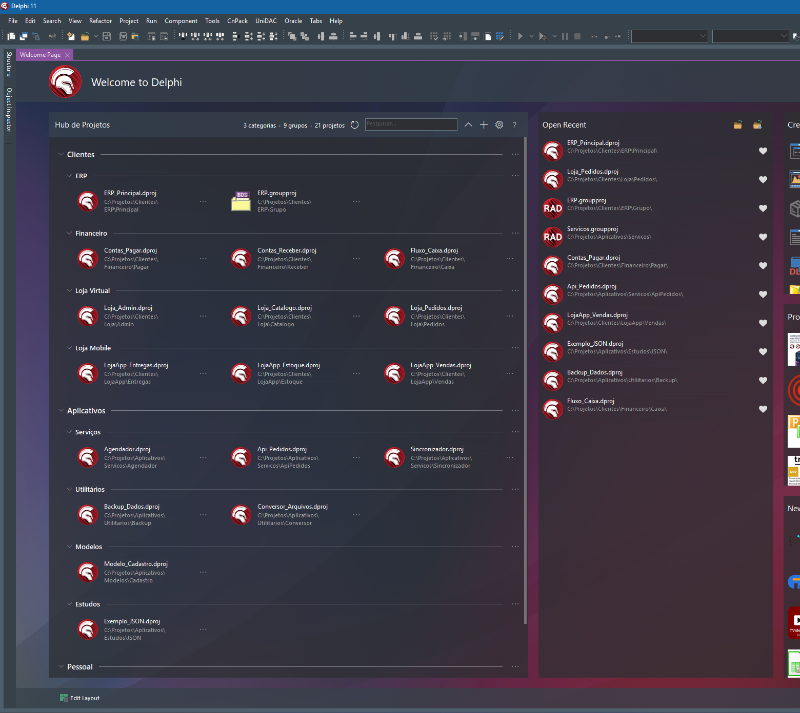
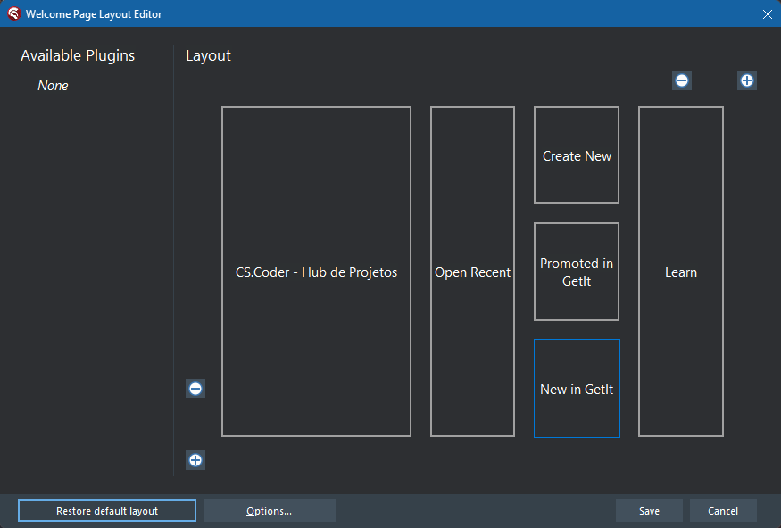
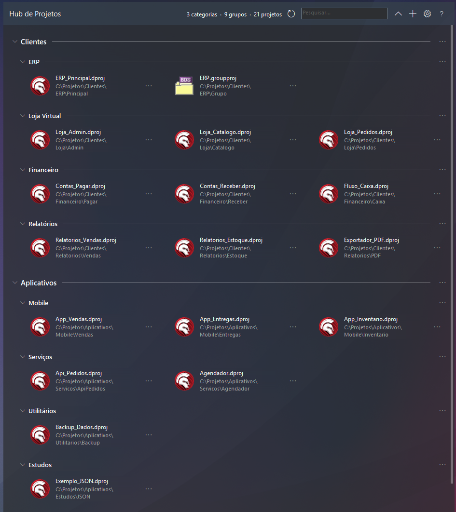
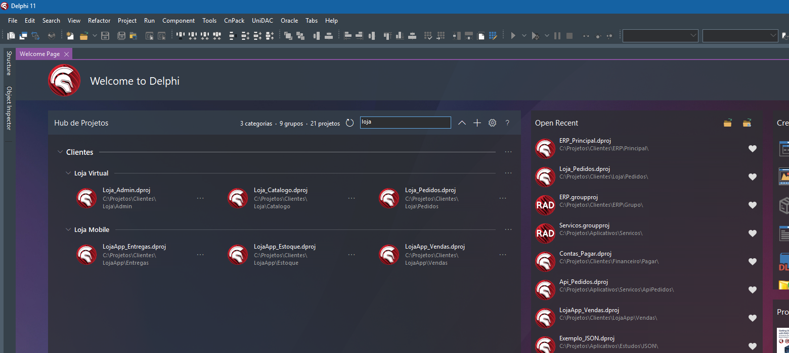
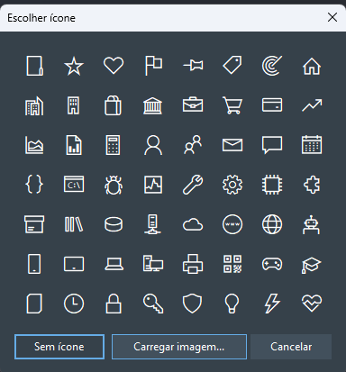
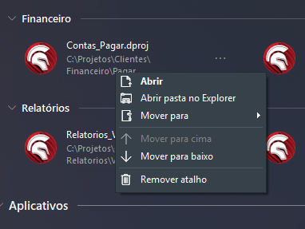
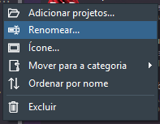

# CS.Coder Project Hub

**English** | [Português (Brasil)](README.pt-BR.md)

CS.Coder Project Hub is an extension for the Welcome Page of Delphi 11, 12 and 13. It adds
a panel where you keep shortcuts to your projects, organized in categories and groups that
you define, with icons, search and manual ordering.

Delphi already gives you convenient access to your recent projects. The Hub does not
replace that. It complements it with an additional layer of organization: a collection
arranged by your own criteria (by client, by system, by area of work) that changes only
when you change it.

Free and open source under the [MIT License](LICENSE), by
[CS.Coder](https://www.cscoder.com.br).



*The Hub, on the left, beside Delphi's own Open Recent panel. Project names and folders
in the screenshots are examples.*

## Quick overview

- **Organized your way.** Categories hold groups, groups hold project shortcuts.
- **Recognizable at a glance.** An optional icon for each category and group.
- **Quick to find.** Search by project name or by path.
- **In your order.** Drag and drop, or sort a group by name.
- **Portable.** Export the whole organization to a JSON file and import it elsewhere.
- **Part of the IDE.** It lives on the Welcome Page and follows the light and dark themes.
- **In your language.** English, Portuguese, Spanish, German and French, picked
  automatically from the language of Windows.
- **Never starts empty.** On the first run it brings in your Delphi favorites and recent
  projects, ready for you to organize.
- **Safe for your work.** The Hub stores shortcuts only. It never deletes or moves project
  files.

## What's new in 0.26.10.15a

- **Double click fixed.** Opening a project with a double click in the list could show an
  error right after the project opened ("has no parent window" or an access violation),
  when Delphi closes the Welcome Page on opening a project. The project now opens after the
  click is over, and the error no longer appears.
- **Package description with the site.** The installer registers the package as
  "CS.Coder - Hub de Projetos (https://www.cscoder.com.br)", the name shown in
  Component > Install Packages.
- **License file with the MIT text only**, so GitHub recognizes it as MIT.

The notes for every version are on the
[Releases page](https://github.com/cscoder69/delphi-project-hub/releases).

## Installation

### Supported versions

| Delphi | 32-bit IDE | 64-bit IDE |
|---|---|---|
| 11 Alexandria | Yes | Not applicable |
| 12 Athens | Yes | Yes |
| 13 Florence | Yes | Yes |

The packages are built with Delphi 11.3, 12.3 and 13.1. A single download covers all of
them.

### Steps

1. **Download.** Open the [Releases page](https://github.com/cscoder69/delphi-project-hub/releases),
   pick the latest release and, under **Assets**, download the file named
   `CSCoderHubProjetos-<version>.zip`. Do not pick "Source code": that one has no
   installer.
2. **Extract.** Unzip the whole file into a folder of your choice. `Install.bat` needs the
   other files that come with it.
3. **Close Delphi.** Close every Delphi window. The installer stops with a message if
   Delphi is running, because the IDE rewrites its package list when it closes.
4. **Run `Install.bat`.** Double-click it. It needs no administrator rights and installs
   for the current Windows user, in every supported Delphi it finds. It prints one line per
   Delphi, for example `[OK] Delphi 12 (32-bit, 64-bit)`.
5. **Open Delphi** and go to the Welcome Page.

### Finding the panel

The panel is listed in the IDE under its original name, **"CS.Coder - Hub de Projetos"**.

If it is not on the Welcome Page after installing:

1. Click **Edit Layout**, at the bottom left of the Welcome Page. The Welcome Page Layout
   Editor opens.
2. Find "CS.Coder - Hub de Projetos" under **Available Plugins** and place it on the
   layout, where you want it.
3. Click **Save**.



*The layout editor after the panel has been placed. A panel that is not on the layout yet
is listed under Available Plugins.*

### Checking each stage

These are three different things, and it helps to know which one you are looking at:

| Stage | How to tell |
|---|---|
| Installation completed | `Install.bat` printed `[OK]` for your Delphi. The packages are in `%LOCALAPPDATA%\CSCoder\Hub\bin`. |
| Panel available | Delphi loaded the package: **Component > Install Packages** lists it, checked, as "CS.Coder - Hub de Projetos (https://www.cscoder.com.br)", and the Welcome Page Layout Editor offers the panel. |
| Panel visible | The panel has been placed on the Welcome Page layout. |

### Updating

Download the newer zip, close Delphi and run its `Install.bat`. Your list is kept.

## Key features

### Categories, groups and icons

The structure has two levels. A **category** holds **groups**, and a **group** holds
project shortcuts. Categories are optional: a group can stand on its own at the top level.

Use the levels for whatever fits your work: clients, companies, systems, areas, studies.
Shortcuts point to `.dproj`, `.groupproj` and `.dpr` files.



Any category or group can have an icon. Choose one of the 56 in the built-in library,
drawn in the text color of the IDE theme, or load an image of your own (PNG, ICO, JPG, BMP
or GIF). Icons are optional, and a line without one keeps its usual look.

Each category and group can be collapsed, and one button in the header collapses or
expands everything.

### Search by name and path

Type in the search box in the panel header. The list shows only the projects whose name
or full path contains what you typed, together with their groups. Upper and lower case
make no difference.



In the example above, typing `loja` leaves only the two groups whose projects have it in
the name or in the folder.

Searching the path is useful when you remember where a project lives but not what it is
called. Typing part of a folder name, such as `Clientes\ERP`, brings up every project
stored under it.

### Your own order

Drag and drop projects, groups and categories, or use the arrows that appear on the line
under the mouse. Projects in a group are listed alphabetically until you move one of them.
From then on that group keeps your order, and **Sort by name** in the group menu takes it
back to alphabetical.

### Export and import

The gear button has **Export configuration...**, **Import and merge...** and **Import and
replace everything...**. They carry your organization to another Delphi version or
another computer. See [Data management](#data-management) for what the file contains.

### Five languages, chosen automatically

The interface is available in English, Portuguese, Spanish, German and French.

You do not need to configure anything. The panel reads the display language of Windows
and uses it. If Windows is in a language other than these five, the panel uses English.

To choose a language yourself, open the gear button and pick one under **Language**. The
first option there, **Automatic (Windows)**, goes back to following Windows. The choice
applies to the panel only and does not change the language of the IDE.

### A useful first run

The panel does not start empty. The first time it opens in a Delphi version, with no list
yet, it reads what Delphi already knows and creates up to two groups:

- **Favorites**, with every project you have marked as a favorite in Delphi. If Delphi
  has no favorites, this group is not created.
- **Recent**, with up to ten of the projects Delphi lists as recent, newest first,
  leaving out the ones that are already in Favorites.

Projects whose file no longer exists are left out.

From there you can open them straight away and start organizing: rename the groups, drag
their projects into your own categories and groups, or delete them. They are ordinary
groups.

This happens only once. After a list exists, the Hub no longer reads Delphi's favorites
or recent projects, and Delphi's own lists are never changed.

### Integrated with the IDE

- **Themes.** Every color comes from the IDE theme, so the panel follows light and dark
  mode and is redrawn when you switch.
- **Opening a project.** Double-click a shortcut, or use **Open** in its menu. The same
  menu has **Open folder in Explorer**.
- **Two IDEs at once.** Two windows of the same Delphi version share one list. Before
  saving a change, the Hub rereads the file, so one window does not overwrite what the
  other did. The **Refresh** button shows the other window's changes.

## Specifications

| | |
|---|---|
| Type | Design-time package for the Delphi IDE, shown as a panel on the Welcome Page |
| Delphi versions | 11 Alexandria, 12 Athens and 13 Florence |
| IDE | 32-bit (11, 12 and 13) and 64-bit (12 and 13) |
| Operating system | Windows, as required by the Delphi IDE |
| Theme | Follows the IDE theme, light or dark. Every color is read from the theme in use, and the panel is redrawn when you switch themes, with Delphi open |
| Languages | English, Portuguese, Spanish, German and French, chosen from the language of Windows or set by hand |
| Project files | `.dproj`, `.groupproj` and `.dpr` |
| Structure | Categories (optional), groups and project shortcuts |
| Icons | 56 built in, or your own image in PNG, ICO, JPG, BMP or GIF |
| Data | One JSON file per Delphi version, in `%LOCALAPPDATA%\CSCoder\Hub` |
| Network | Not used. No data is collected or sent |
| Installation | Per Windows user, with no administrator rights |
| License | MIT, free and open source |

## Screenshots

| Choosing an icon | Project and group menus |
|---|---|
|  | <br> |

The screenshots show the Portuguese interface.

## Your projects remain untouched

The Hub works with shortcuts, which are references to project files that already exist.
It does not own your projects and does not manage their folders.

- **Remove shortcut** takes the entry off the list. The project file stays where it is.
  The confirmation dialog says so before you confirm.
- **Deleting a group or a category** removes shortcuts from the list, never project files.
- **Moving a shortcut** to another group or category changes only the list. Nothing moves
  on disk.
- **Exporting** saves your organization. It is not a backup of your source code.
- **Uninstalling the Hub** removes the extension. It does not touch your projects.

The Hub writes only its own files: the list, its backup copy, the icon images you loaded
and its language setting. The source code has no call that deletes, moves or renames any
other file, and you are welcome to check it in `CSCoderHub/src/`.

## Data management

### Where the list is stored

The list is a JSON file on your computer:

```
%LOCALAPPDATA%\CSCoder\Hub\D11\projects.json
%LOCALAPPDATA%\CSCoder\Hub\D12\projects.json
%LOCALAPPDATA%\CSCoder\Hub\D13\projects.json
```

- Each Delphi version has its own list. The 32-bit and 64-bit IDEs of the same version
  share it.
- Each time the list is saved, the previous version is kept as `projects.json.bak`.
- Icon images that you loaded are stored in an `icons` folder next to the list.
- The language you chose is kept in `%LOCALAPPDATA%\CSCoder\Hub\settings.json`, one file
  for every Delphi version. The Hub keeps no setting in the Windows registry.
- The Hub does not use the network. Nothing is collected or sent anywhere.

### Exporting

**Gear button > Export configuration...** writes one JSON file containing:

- your categories and groups, with their order and collapsed state;
- each shortcut, with its name and the full path of the project file;
- the icon chosen for each category and group;
- the icon images you loaded, embedded in the file.

The file holds the organization and the paths. It does not hold the projects themselves.

### Importing

- **Import and merge...** adds what is missing and leaves the rest as it is. A category
  or group that already exists keeps its icon, and a project that already has a shortcut
  does not get a second one.
- **Import and replace everything...** asks for confirmation and then replaces the whole
  list with the one in the file. The list you had is kept as `projects.json.bak`.

A file with no categories and no groups is refused, and your list is left unchanged.

### Moving to another computer

Shortcuts store full paths. On another computer the projects need to be in the same
locations. A shortcut whose file is not found stays on the list, marked as
`[missing file]`, until you remove it or add the project again from its new location.

## Uninstallation

Close Delphi first. The uninstaller, like the installer, stops if Delphi is running.

### Remove the extension and keep your list

```
Uninstall.bat
```

This removes the Hub from every Delphi version and deletes the installed packages. Your
list, its backup and your icon images are kept, so installing again brings everything
back.

### Remove the extension and its data

```
Uninstall.bat /data
```

> [!WARNING]
> This also deletes the list of every Delphi version, the backup copies, the icon images
> you loaded and the language setting. It cannot be undone unless you have an exported
> copy. To keep one, open Delphi **before uninstalling** and use
> **Gear button > Export configuration...** in each Delphi version whose list you want
> to keep.

Neither command touches your projects.

## Build from source

`CSCoderHub/build.bat [11|12|13|all]` compiles the packages with the command-line
compilers of each Delphi. Edit the three installation paths at the top of the file to
match your machine. `CSCoderHub/package.bat` builds everything and also assembles
`CSCoderHub/dist/`.

There is no `.dproj`. There is one `.dpk` per Delphi version, and all of them share the
same units. To load a package you built, use **Component > Install Packages > Add** and
pick the `.bpl` from `CSCoderHub/bin/` (32-bit IDE) or `CSCoderHub/bin/Win64/` (64-bit
IDE).

The data file format and the known limitations are in the technical reference,
[CSCoderHub/README.md](CSCoderHub/README.md).

## Repository structure

- `CSCoderHub/src/`: the extension sources (`CSCoder.Hub.*` units)
- `CSCoderHub/packages/`: one `.dpk` per Delphi version and the shared version resource
- `CSCoderHub/installer/`: the per-user install and uninstall scripts shipped in the zip
- `CSCoderHub/installer-readme/`: the text files shipped in the zip
- `CSCoderHub/dist/`: ready-made packages
- `docs/images/`: images used by this page

## How it was made

The author has worked professionally with Delphi for many years, building desktop, mobile
and web applications, including UniGUI solutions. Working with many systems and clients
at the same time brought a practical need: a place on the Welcome Page to keep project
shortcuts arranged in a personal way.

CS.Coder Project Hub is that need turned into a tool and shared with the community. It
was developed with Claude Code, Anthropic's coding assistant, used as a productivity
resource. The requirements, the product decisions, the visual design, the testing inside
the IDE and the approval of every screen are the author's. Most of the code was written by
the assistant and checked with test programs before each delivery.

The first version went from idea to public repository in less than 24 hours, in October
2026. That says something about what these tools make possible. It is not offered as a
measure of quality: the project is open so that anyone can read the code, try it and
report what can be better.

## Contributing and support

- **Problems and suggestions:** open an
  [issue](https://github.com/cscoder69/delphi-project-hub/issues). In the panel, the **?**
  button opens the About window, and its **Report a problem** link leads to that page.
- **Contributions:** pull requests are welcome. For a larger change, please open an issue
  first so we can agree on the approach.
- **Contact:** contato@cscoder.com.br

## License and acknowledgements

Released under the [MIT License](LICENSE). Copyright (c) 2026 CS.Coder.

"Delphi" and "RAD Studio" are trademarks of Embarcadero Technologies, Inc. CS.Coder
Project Hub is an independent project. It is not affiliated with, maintained by or
endorsed by Embarcadero.
