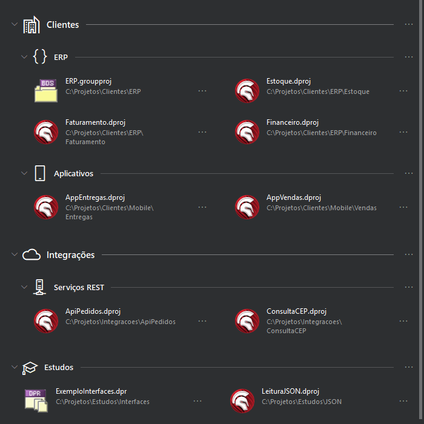
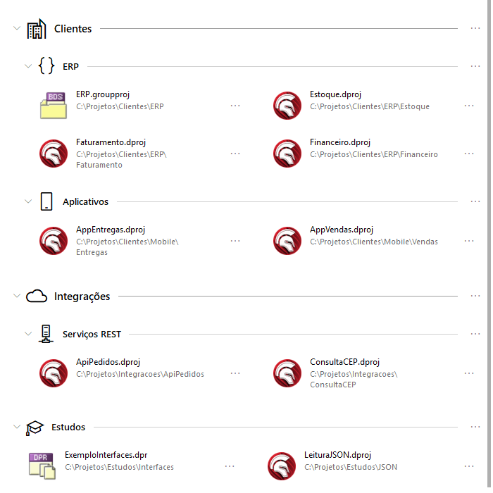
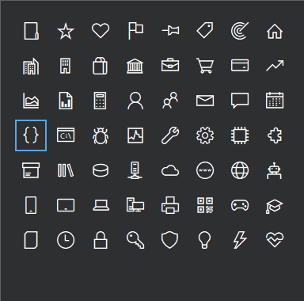

1# CS.Coder - Hub de Projetos

[English](README.md) | **Português (Brasil)**

Um painel para a Welcome Page do Delphi 11, 12 e 13 que deixa seus projetos a um duplo
clique, organizados em categorias e grupos, com ícones, busca, arrastar e soltar e
exportar/importar. Gratuito e de código aberto sob a [licença MIT](LICENSE), da
[CS.Coder](https://www.cscoder.com.br).

## Por quê

A lista "Open Recent" da IDE é plana e esquece: o projeto de que você precisa é sempre o
que caiu do fim dela. O Hub troca isso por uma lista que você mesmo organiza e que só muda
quando você mudar: por cliente, por sistema, pela frente de trabalho do mês. Ele vive
dentro da Welcome Page, desenhado no mesmo estilo dos painéis nativos, para parecer que
veio com o Delphi.

## Funcionalidades

- **Categorias e grupos.** Dois níveis: a categoria contém grupos, o grupo contém atalhos
  de projetos. A categoria é opcional; um grupo pode ficar solto.
- **Ýcones.** Toda categoria ou grupo pode ter um ícone: um dos 56 da biblioteca, desenhado
  na cor de texto do tema, ou uma imagem sua (PNG, ICO, JPG, BMP ou GIF), que o plugin
  reduz e guarda. Sem ícone, a linha fica exatamente como era.
- **Busca.** Digite e a lista mostra só os projetos cujo nome ou caminho combinam, com os
  seus grupos.
- **A sua ordem.** Arraste e solte projetos, grupos e categorias, ou use as setas. Os
  projetos vêm em ordem alfabética até você mover um; "Ordenar por nome" desfaz.
- **Recolher e expandir.** Cada categoria e grupo lembra o estado; um botão no cabeçalho
  abre ou fecha tudo.
- **Exportar e importar.** A lista inteira em um arquivo JSON, com as suas imagens de ícone
  embutidas, para levar a outro Delphi ou guardar como backup. Importar pode mesclar (só
  acrescenta o que falta) ou substituir tudo.
- **Uma lista por versão do Delphi.** O 11, o 12 e o 13 têm cada um a sua; as IDEs de 32 e
  64 bits da mesma versão compartilham.
- **Duas IDEs abertas.** Um botão de atualizar relê a lista, e toda alteração relê o arquivo
  antes de gravar, para duas janelas do mesmo Delphi nunca se sobrescreverem.
- **Cinco idiomas.** Português, inglês, espanhol, alemão e francês, seguindo o Windows ou
  escolhido no menu de configurações.
- **Claro e escuro.** Toda cor vem do tema da IDE; trocar o tema redesenha o painel.
- **Primeira abertura útil.** Sem lista ainda, o painel começa com um grupo "Recentes"
  com os projetos que a própria IDE lista como recentes, prontos para arrastar para
  categorias.
- **Seus dados são seus.** A lista é um arquivo JSON no seu computador. Nada é coletado nem
  enviado a lugar nenhum.

| Tema claro | Escolhendo um ícone |
|---|---|
|  |  |

## Instalação

1. Baixe `CSCoderHubProjetos-<versão>.zip` de `CSCoderHub/dist/` (ou de Releases) e
   descompacte.
2. Feche o Delphi e execute `Install.bat`. Ele instala para todos os Delphi compatíveis do
   usuário atual do Windows, sem pedir administrador.
3. Abra o Delphi. Se o painel não estiver na Welcome Page, clique em **Edit Layout** e
   posicione "CS.Coder - Hub de Projetos" na grade.

`Uninstall.bat` remove e mantém a sua lista; `Uninstall.bat /data` apaga a lista também.

## Compilar a partir do código

`CSCoderHub/build.bat [11|12|13|all]` compila os pacotes com os compiladores de linha de
comando de cada Delphi (ajuste os três caminhos de instalação no início do arquivo para a
sua máquina); `CSCoderHub/package.bat` também monta a pasta `dist/`. Não há `.dproj`: um
`.dpk` por versão do Delphi, todos com as mesmas units. Detalhes, formato do arquivo de
dados e limitações conhecidas em [CSCoderHub/README.md](CSCoderHub/README.md) (em inglês).

## Estrutura do repositório

- `CSCoderHub/src/` - os fontes do plugin (units `CSCoder.Hub.*`)
- `CSCoderHub/packages/` - um `.dpk` por versão do Delphi
- `CSCoderHub/installer/` - os scripts de instalar / desinstalar que vão no zip
- `CSCoderHub/dist/` - pacotes prontos (zip de instalação manual e pacotes do GetIt)
- `docs/` - imagens desta página

## Como foi feito

O Hub nasceu de um incômodo pessoal: os projetos favoritos nunca estavam à mão na Welcome
Page. A lista de recentes mostrava o que foi aberto por último, não o que importa, e o
projeto certo exigia navegar por pastas toda vez. A solução foi fazer o painel que faltava,
no lugar onde ele faltava.

Foi construído em um dia, 9 de outubro de 2026, pela CS.Coder em conversa com o Claude Code
(assistente de programação da Anthropic). As decisões de produto, o visual, cada medida, os
testes dentro da IDE e a aprovação de cada tela são do autor; a maior parte do código foi
escrita pelo assistente e verificada com programas de teste fora da IDE antes de cada
entrega. É o lema da CS.Coder em prática: **código com propósito, soluções com
inteligência**.

## Suporte

Problemas e sugestões: abra uma issue aqui. Contato: contato@cscoder.com.br.

"Delphi" e "RAD Studio" são marcas da Embarcadero Technologies, Inc. A CS.Coder não tem
vínculo com a Embarcadero.
